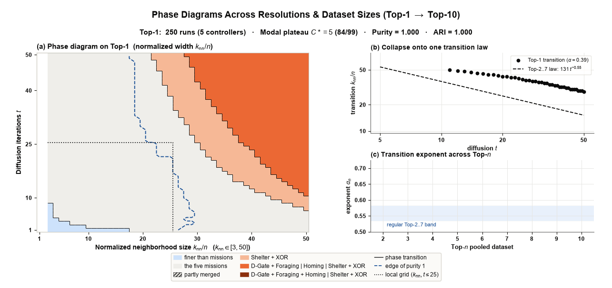
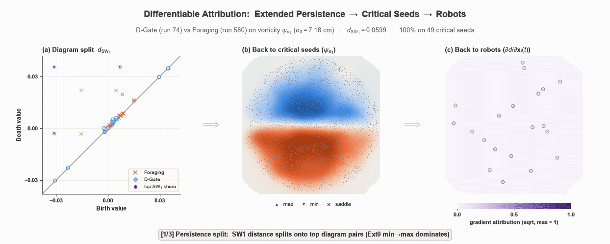

# Recovering a Taxonomy of Collective Behaviors from Trajectories Alone

[](requirements.txt)
[](LICENSE)
[](https://doi.org/10.5281/zenodo.24254004)
[](https://doi.org/10.5281/zenodo.23440748)

From tracked 2-D positions alone—with no labels, task objectives, or fixed cluster count—this work recovers an **unsupervised behavioral taxonomy** of swarm recordings: five $\mathrm{SO}(2)$-invariant Gaussian-splatted fields ($\rho, K, \varphi, \psi, J$) evaluated on grid-free seeds, summarized by extended persistence, compared via sliced Wasserstein distance ($\mathrm{SW}_1$), fused across four data-driven scales by Similarity Network Fusion (SNF), and clustered via Affinity Propagation (`Purity 0.999–1.000` across `250–2,500` runs). Because the entire chain is differentiable, any distance traces directly back to critical field structures and individual robots.

📄 **Paper:** [`manuscript/paper.pdf`](manuscript/paper.pdf) (Zenodo preprint [`10.5281/zenodo.24254004`](https://doi.org/10.5281/zenodo.24254004), full paper with appendices) · [`manuscript/journal.pdf`](manuscript/journal.pdf) + [`manuscript/supplementary.pdf`](manuscript/supplementary.pdf)


---

## Reproducing the Results

### 1. Environment & End-to-End Pipeline

```bash
git clone https://github.com/Vertu5/paper_topological_kinematics.git
cd paper_topological_kinematics
pip install -r requirements.txt

# Place raw ARGoS tracks in data/ (or unpack the Zenodo derived archives into results/), then run:
nohup nice -n 19 bash analysis/run_all.sh > results/run_all.log 2>&1 &

# Resume from a specific stage (e.g. sweep, figures, numbers)
FROM=figures bash analysis/run_all.sh
```

On CUDA (`torch` + `triton`), stages 1, 3, fusion, Affinity Propagation, and differentiable attribution run on GPU; without CUDA, the identical mathematical method executes on CPU (distances, SNF, and Affinity Propagation match CPU/GPU bit for bit).

### 2. Standalone Code Verification

```bash
python analysis/verify_code.py            # Code vs closed-form formulas & CPU/GPU parity
python analysis/make_numbers.py           # Verifies 136 textual claims from derived results
```

---

## Repository Structure

```text
paper_topological_kinematics/
│
├── run_pipeline.py                # Stages 1–3: grid-free seeds + fields, extended persistence, SW1 distances
├── run_sweep.py                   # Resolution sweep, SNF fusion, ablations & modal consensus taxonomy
├── make_zenodo_bundle.sh          # Builds Zenodo data & code archive (10.5281/zenodo.23440748)
├── make_submission_bundle.sh      # Builds Swarm Intelligence submission bundle
│
├── src/
│   ├── gaussian_splatting/        # Closed-form fields (CPU/GPU), grid-free seeds, alpha complex, persistence, SW1
│   └── classification/            # Rank normalization, balanced cross-scale SNF, Affinity Propagation (CPU/GPU)
├── pipeline/                      # Config, ARGoS CSV loader, checkpoints & stage runners
├── analysis/                      # Reproduction script (run_all.sh), figures, baselines, attribution & audits
├── notebooks/                     # Pre-executed educational & reproduction notebooks (00–07)
├── assets/                        # Animated explanatory GIFs for kinematics, persistence, phases & attribution
└── figures/                       # Publication figures (PDF + PNG)
```

---

## Notebooks ([`notebooks/`](notebooks/))

| Notebook | Content |
| :--- | :--- |
| [`00_paper_figures.ipynb`](notebooks/00_paper_figures.ipynb) | Regenerates all paper and appendix figures + `make_numbers.py` audit (`136/136` claims) |
| [`01_data_and_fields.ipynb`](notebooks/01_data_and_fields.ipynb) | Gaussian footprint, velocity moments (<i>M</i><sub>0</sub>, <b>M</b><sub>1</sub>, <b>M</b><sub>2</sub>), closed-form HHD, Jacobi coupling <i>J</i><sub>&sigma;</sub>, $\mathrm{SO}(2)$ invariance |
| [`02_scales_domain_persistence.ipynb`](notebooks/02_scales_domain_persistence.ipynb) | Data-driven scale ladder ($\sigma_1 \dots \sigma_4$), 3-family grid-free alpha complex & extended persistence |
| [`03_distances_and_fusion.ipynb`](notebooks/03_distances_and_fusion.ipynb) | Diagonal-augmented $\mathrm{SW}_1$, mutual-rank normalization & moment-balanced SNF fusion |
| [`04_taxonomy.ipynb`](notebooks/04_taxonomy.ipynb) | Affinity Propagation modal consensus (`84/99` on Top-1), resolution maps & transition scaling (`Top-1..10`) |
| [`05_hierarchy_and_fields.ipynb`](notebooks/05_hierarchy_and_fields.ipynb) | Coarse merge sequence (`D-Gate + Foraging`, `Shelter + XOR`, `Homing`) & pairwise field separation |
| [`06_ablation_baselines_robustness.ipynb`](notebooks/06_ablation_baselines_robustness.ipynb) | Field ablations, baseline comparisons, rotation invariance & parameter sensitivity |
| [`07_attribution.ipynb`](notebooks/07_attribution.ipynb) | Differentiable PyTorch back-propagation to critical seeds and robots + 2 mm noise stability |

---

## Method Visualizations

### 1. From Swarm Trajectories to Time-Averaged Fields


### 2. Extended Persistence Filtration


### 3. Phase Diagrams & Transition Scaling (`Top-1` → `Top-10`)


*Static 10-panel phase diagram: [`figures/fig_states.png`](figures/fig_states.png).*

### 4. Differentiable Gradient Attribution Back to Robots


---

## Data & License

- **Preprint:** [`manuscript/paper.pdf`](manuscript/paper.pdf), deposited on Zenodo under [`10.5281/zenodo.24254004`](https://doi.org/10.5281/zenodo.24254004) (CC BY 4.0).
- **Upstream trajectories:** 2,500 simulated ARGoS runs of 20 e-puck robots across five missions (10 AutoMoDe-Chocolate controllers per mission $\times$ 50 seeds) from [Legarda Herranz et al. (2026)](https://github.com/glegarda/swarm-tda) and [Hasselmann et al. (2021)](https://doi.org/10.1038/s41467-021-24642-3).
- **Derived results & code archive:** [`10.5281/zenodo.23440748`](https://doi.org/10.5281/zenodo.23440748) (`make_zenodo_bundle.sh`).
- **License:** Code under the **MIT License** ([`LICENSE`](LICENSE)); Zenodo derived results and preprint under **CC BY 4.0**.
