# 🧭 Topological Kinematics — Unsupervised Taxonomy of Collective Behaviors

[](requirements.txt)
[](LICENSE)
[](https://doi.org/10.5281/zenodo.23440748)
[](manuscript/journal.pdf)
[](manuscript/lean/README.md)

**Recovering a Taxonomy of Collective Behaviors from Motion Alone** transforms raw 2-D multi-agent trajectories into an **unsupervised behavioral taxonomy**: how many distinct behaviors appear across recordings, which runs share each behavior, one real recording (**the exemplar**) representing each cluster, how behaviors nest across resolutions, and which physical structures and robot motions set any two behaviors apart.

📄 **Paper ([full arXiv](manuscript/paper.pdf) · [journal manuscript](manuscript/journal.pdf) · [supplementary](manuscript/supplementary.pdf))** &nbsp;|&nbsp; 📓 **[Interactive Notebooks (00–07)](notebooks/)** &nbsp;|&nbsp; 🧪 **[Formal & Numerical Audits](manuscript/lean/README.md)**

---

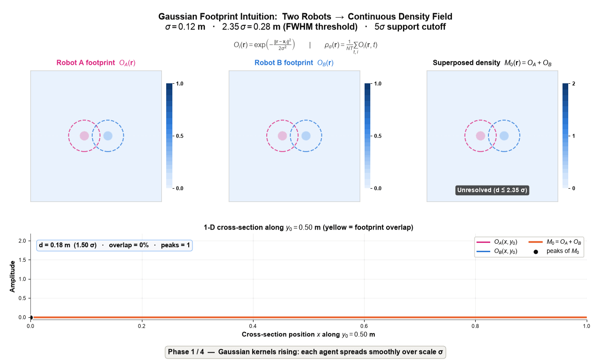

> **Intuition behind the method:** Every agent emits an isotropic Gaussian footprint $O_i(\mathbf{r}, t)$ of width $\sigma$. Nearby agents merge into a single ridge below the Rayleigh threshold ($d \le 2.35\,\sigma$) and resolve into separate peaks above it—making $\sigma$ a continuous observation lens from individual encounters to arena-wide traffic.

---

## 📌 Problem Formulation & Core Goal

Standard swarm behavior analysis relies on mission-specific order parameters or supervised classifiers. Here, **no task objective, controller ID, or behavioral label ever enters the pipeline**:

- **Input**: Tracked 2-D robot positions $\mathbf{x}_i(t)$ (e.g., 20 e-puck robots recorded every $0.1\text{ s}$ inside a $4.91\text{ m}^2$ ARGoS arena).
- **Process**: Exact Gaussian splatting of velocity moments $\to$ five $\mathrm{SO}(2)$-invariant scalar fields at four label-free scales $\to$ grid-free extended persistence diagrams $\to$ order-1 sliced Wasserstein distances ($\mathrm{SW}_1$) $\to$ moment-balanced mutual-rank Similarity Network Fusion (SNF) $\to$ Affinity Propagation modal consensus.
- **Output**: Label-free recovery of the number of behaviors $C^\star$, clean behavioral partitions (**Purity `0.999–1.000`** across `250–2,500` runs), representative exemplars, a multi-resolution hierarchy of motion families, and exact differentiable attribution back to critical field points and individual robots.

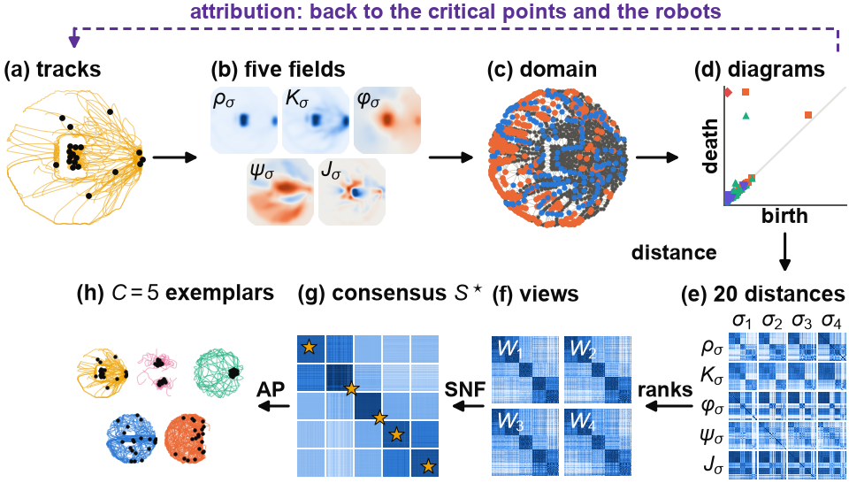

```
Tracked trajectories x_i(t)
        │
        ▼
  Velocity Moments (M0, M1, M2)  ──►  5 SO(2)-Invariant Fields  (ρ, K, φ, ψ, J) at 4 data-driven scales σ₁…σ₄
        │
        ▼
  Grid-Free 3-Family Seeds       ──►  Extended Persistence (6 finite diagrams: Ord0, Ord1, Rel1, Rel2, Ext0, Ext1)
        │
        ▼
  Sliced Wasserstein SW1 (25 θ)  ──►  20 Distance Matrices ──► Mutual-Rank Balanced Views W_m ──► SNF Consensus S*
        │
        ▼
  Affinity Propagation Consensus ──►  Taxonomy C*, Exemplars, Resolution Hierarchy & Differentiable Attribution
```

---

## 🚀 Method & Mathematical Background

### 1. Closed-Form Kinematic Fields (`M₀, M₁, M₂` & `SO(2)` Invariance)

With Gaussian footprint $O_i(\mathbf{r}, t) = \exp\!\left(-\|\mathbf{r} - \mathbf{x}_i(t)\|^2 / (2\sigma^2)\right)$ (truncated at $5\sigma$, omitting less than $e^{-12.5} \approx 3.73 \times 10^{-6}$ of total mass), the first three time-averaged velocity moments reduce under planar rotations to **five scalar fields** evaluated without any Cartesian grid or finite-difference solver:

$$\rho_\sigma(\mathbf{r}) = \frac{1}{NT}\sum_{t,i} O_i(\mathbf{r}, t), \qquad K_\sigma(\mathbf{r}) = \frac{1}{NT\langle\|\mathbf{v}\|^2\rangle}\sum_{t,i} \|\mathbf{v}_i(t)\|^2 O_i(\mathbf{r}, t)$$

$$\varphi_\sigma(\mathbf{r}) = c\sum_{t,i} (\mathbf{v}_i \cdot \mathbf{d}_{t,i})\,\kappa_\sigma(\|\mathbf{d}_{t,i}\|), \qquad \psi_\sigma(\mathbf{r}) = -c\sum_{t,i} \det(\mathbf{v}_i, \mathbf{d}_{t,i})\,\kappa_\sigma(\|\mathbf{d}_{t,i}\|)$$

$$J_\sigma(\mathbf{r}) = \sigma^2 \det\!\big(\nabla\varphi_\sigma(\mathbf{r}),\,\nabla\psi_\sigma(\mathbf{r})\big), \qquad \kappa_\sigma(r) = \frac{\sigma^2}{r^2}\left(1 - e^{-r^2/(2\sigma^2)}\right), \quad \kappa_\sigma(0)=\frac{1}{2}$$

Here $\mathbf{d}_{t,i} = \mathbf{r} - \mathbf{x}_i(t)$ and $c = (NT\sigma\bar{v})^{-1}$. By Proposition 1 (proved symbolically and in Lean 4), $\nabla\varphi_\sigma + \nabla^\perp\psi_\sigma$ reconstructs the exact Gaussian momentum flux with zero boundary or harmonic ambiguity. Meanwhile **$J_\sigma$** captures the relative placement of sinks/sources ($\varphi_\sigma$) and rotation centers ($\psi_\sigma$), which separate diagrams cannot see.

### 2. Label-Free Geometric Scale Ladder & Grid-Free Domain

Four geometric scales are computed once from unlabeled trajectory spacings ($d_{\min}$) and swarm diameter ($D_s$), floored at tracking noise $\epsilon_\sigma = 1.0\text{ cm}$ and capped with $k = 10$ to avoid over-smoothing internal corridors:

$$\sigma_{\mathrm{ladder}} = [3.37,\; 4.92,\; 7.18,\; 10.47]\text{ cm}$$

Per recording and scale, fields are sampled on an adaptive **3-family point cloud** (farthest-point robot coreset of radius $\sigma_m/2$, near-critical Delaunay barycenters, and bisection zeros along $J_\sigma = 0$), filtered via an alpha complex of radius $(3\sigma_m)^2$.

### 3. Extended Persistence & Moment-Balanced SNF

An upward sublevel sweep followed by a downward superlevel sweep turns every extremum and saddle into finite birth–death pairs across **six sub-diagrams** ($\mathrm{Ord}_0, \mathrm{Ord}_1, \mathrm{Rel}_1, \mathrm{Rel}_2, \mathrm{Ext}_0, \mathrm{Ext}_1$). Recordings are compared via order-1 sliced Wasserstein distance ($\mathrm{SW}_1$, $25$ projection directions). Each of the $5 \times 4 = 20$ matrices is normalized by mutual rank and percentile rank, averaged into four scale views with **equal weight per physical moment** ($1/3$ density $\rho_\sigma$, $1/3$ kinetic $K_\sigma$, $1/9$ each for $\varphi_\sigma, \psi_\sigma, J_\sigma$), fused by SNF ($k_{\mathrm{nn}}=7, t=10$), and clustered with Affinity Propagation (`damping = 0.9`, `convergence_iter = 100`, `max_iter = 1000`).

---

## 🎨 Mission Palette & Color Legend

All spatial trajectories, resolution maps, and diagnostic plots use consistent color-blind-safe mission colors ([`analysis/figlib.py`](analysis/figlib.py)):

| Swatch | Color / Hex | Mission | Collective Strategy | Primary Separating Field |
| :--- | :---: | :--- | :--- | :--- |
| 🔵 | `#2a78d6` | **D-Gate** *(Directional Gate)* | Sustained unidirectional traffic loop through gate | Vorticity $\psi_\sigma$ (`3.35` vs Foraging) |
| 🟠 | `#eb6834` | **Foraging** | Arena-wide Lévy / random-walk sweeping | Vorticity $\psi_\sigma$ & low aggregation |
| 🟢 | `#1baf7a` | **Homing** | Full-arena initial search collapsing to one nest | Kinetic $K_\sigma$ (`6.49` vs Shelter) & $\varphi_\sigma$ (`7.27` vs Foraging) |
| 🟡 | `#eda100` | **Shelter** | Gradual sheltering around dark center + wall paths | Divergence $\varphi_\sigma$ (`3.34` vs XOR) |
| 🩷 | `#e87ba4` | **XOR** *(XOR Aggregation)* | Symmetric congregation on one or two black patches | Divergence $\varphi_\sigma$ & $J_\sigma$ (`2.75` vs Shelter) |

> **Field colormaps:** Non-negative fields ($\rho_\sigma, K_\sigma$) use a white-to-blue sequential palette; signed fields ($\varphi_\sigma, \psi_\sigma, J_\sigma$) use a perceptually balanced brown–white–blue diverging palette centered at $0$.

---

## 📊 Key Experimental Results (`Top-1` to `Top-10`)

Pooling the top $n \in \{1, \dots, 10\}$ AutoMoDe-Chocolate controllers per mission ($250n$ runs, $99$ local settings per dataset) recovers pure behaviors throughout while automatically revealing genuine sub-strategies inside missions (`C*` saturating at `11` across `50` controllers):

| Dataset | Runs | Modal $C^\star$ (`plateaus/99`) | Stability | Purity | Misassigned | Homogeneity | Completeness | ARI vs Mission |
| :--- | ---: | :---: | :---: | :---: | ---: | :---: | :---: | :---: |
| **Top-1** | 250 | **5** (`84/99`) | 1.000 | **1.000** | **0** | 1.000 | 1.000 | **1.000** |
| **Top-2** | 500 | 6 (`33/99`) | 0.994 | **1.000** | **0** | 1.000 | 0.921 | 0.935 |
| **Top-3** | 750 | 7 (`43/99`) | 0.993 | **1.000** | **0** | 1.000 | 0.860 | 0.875 |
| **Top-4** | 1,000 | 7 (`32/99`) | 0.992 | **1.000** | **0** | 1.000 | 0.872 | 0.893 |
| **Top-5** | 1,250 | 8 (`23/99`) | 0.988 | **1.000** | **0** | 1.000 | 0.838 | 0.868 |
| **Top-6** | 1,500 | 8 (`18/99`) | 0.990 | **0.999** | 1 | 0.997 | 0.836 | 0.870 |
| **Top-7** | 1,750 | 9 (`19/99`) | 0.979 | **1.000** | **0** | 1.000 | 0.806 | 0.837 |
| **Top-8** | 2,000 | 11 (`19/99`) | 0.976 | **0.999** | 2 | 0.997 | 0.747 | 0.766 |
| **Top-9** | 2,250 | 11 (`18/99`) | 0.968 | **0.999** | 2 | 0.997 | 0.724 | 0.720 |
| **Top-10** | 2,500 | 11 (`17/99`) | 0.981 | **1.000** | 1 | 0.999 | 0.745 | 0.762 |

Only **6 misassigned runs out of 13,750 total** (`Top-1` through `Top-10`). On regular pooled datasets (`Top-2` to `Top-7`), state boundaries follow a shared power law $k_{\mathrm{nn}}/n = 131\,t^{-0.55}$, whereas on `Top-8..10` the exponent steepens and isolates atypical controllers (`10th` Shelter cruising like traffic; `10th` XOR settling like Shelter) without labels.

### Baseline Comparison Under Identical Fusion & Clustering

| Representation | Top-1 $C^\star / C$ | Top-1 Purity | Top-1 ARI | Top-10 $C^\star / C$ | Top-10 Purity | Top-10 ARI |
| :--- | :---: | :---: | :---: | :---: | :---: | :---: |
| **Persistence diagrams (method)** | **5 (84)** | **1.000** | **1.000** | **11 (17)** | **1.000** | **0.762** |
| **Diagrams and values** | 5 (79) | 1.000 | 1.000 | 10 (16) | 1.000 | 0.787 |
| Value distributions | 5 (71) | 1.000 | 1.000 | 12 (14) | 0.998 | 0.660 |
| CROCKER curves of positions | 4 (66) | 0.796 | 0.771 | 7 (21) | 0.804 | 0.667 |
| Order parameters | 6 (30) | 0.864 | 0.692 | 16 (11) | 0.797 | 0.362 |
| Finest / Coarsest / Averaged scale | $C=13 / 16 / 12$ | 0.972–1.000 | 0.425–0.573 | $C=58 / 78 / 66$ | 0.992–0.999 | 0.114–0.157 |
| Potential persistence* (reported baseline) | 5 (fixed) | 0.916 | 0.807 | — | — | — |

---

## 🎬 Visualizations & Output Analysis

### 1. Live Swarm Trajectories → Time-Averaged Invariant Fields

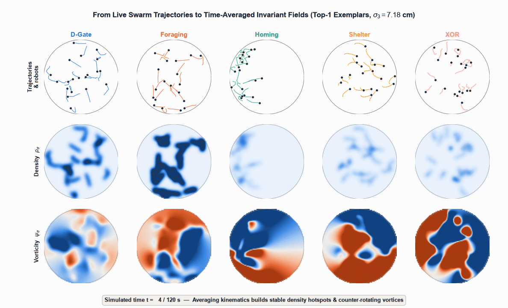

*Animation over the full 120 s run of the 5 Top-1 exemplars at $\sigma_3 = 7.18\text{ cm}$: time-averaging builds crisp corridor hotspots in D-Gate ($\rho_\sigma$) alongside opposing vorticity lobes ($\psi_\sigma$), whereas Foraging exhibits a single diffuse circulation and XOR yields twin static patches.*

### 2. Extended Persistence Filtration Intuition

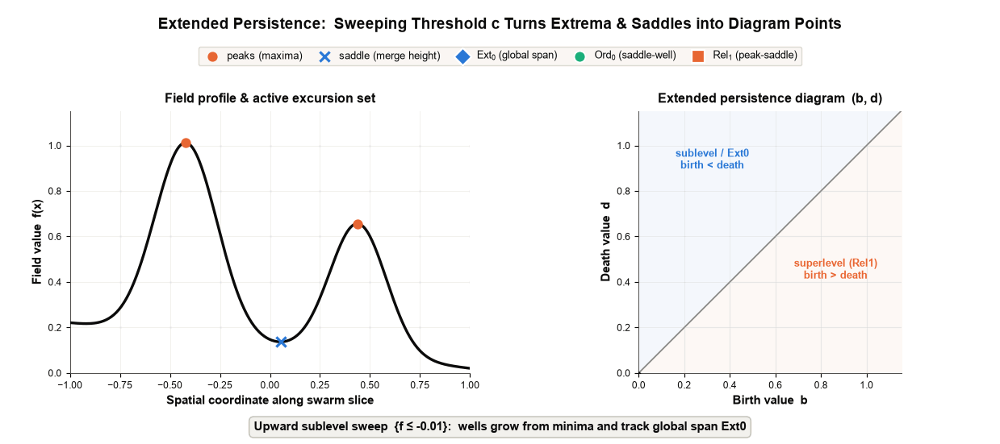

*An upward sublevel sweep (`{f ≤ c}`) closes saddle-well pairs ($\mathrm{Ord}_0$) and the global min–max span ($\mathrm{Ext}_0$), while a downward superlevel sweep (`{f ≥ c}`) captures secondary peak merges into $\mathrm{Rel}_1$ with finite birth–death coordinates.*

### 3. Curated Paper Figures Gallery

| Coupling Detector (`fig_potentials.png`) | Five Fields Across Exemplars (`fig_fields.png`) |
| :---: | :---: |
| 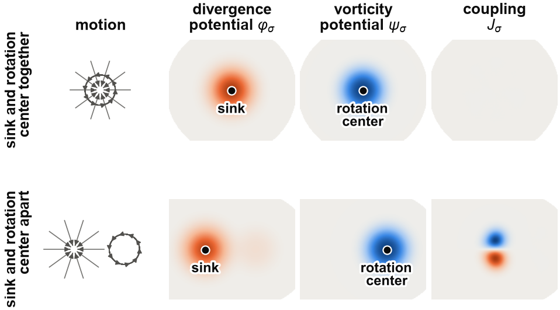 | 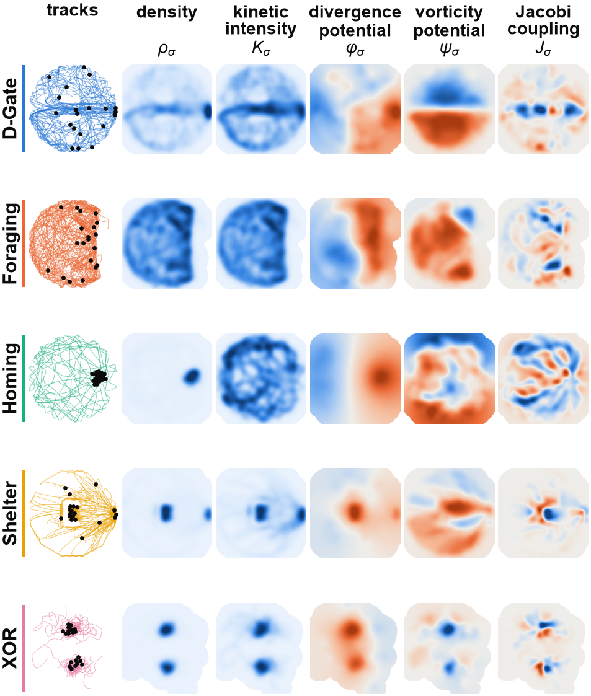 |
| *Coinciding sink + vortex yields $J_\sigma \approx 0$; separating them activates $J_\sigma$.* | *All 5 closed-form scalar fields at $\sigma_3 = 7.18\text{ cm}$ for each Top-1 exemplar.* |

| Resolution Maps Top-1 & Top-10 (`fig_resolution_compact.png`) | Nested Global Stable States (`fig_states.png`) |
| :---: | :---: |
| 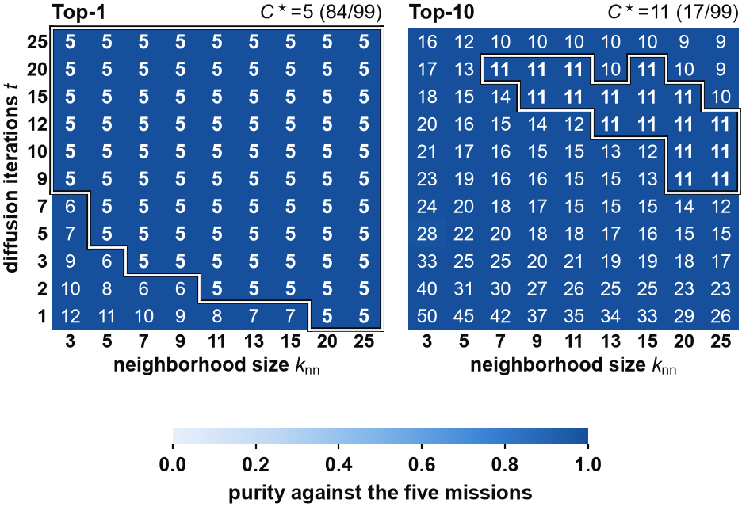 | 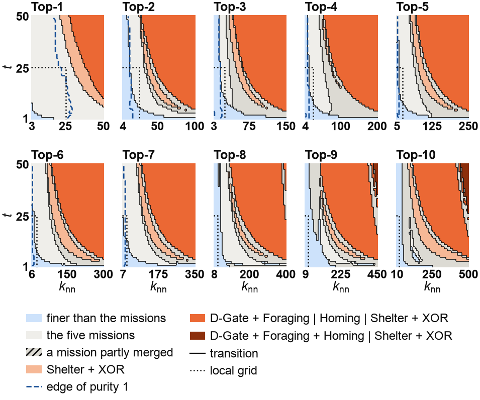 |
| *Wide modal plateau ($84/99$) on Top-1; fine sub-behaviors ($1.000$ purity) on Top-10.* | *Proportional neighborhood sweep reveals nested states and power-law transitions.* |

| Mission Merge Hierarchy (`fig_fusion_sequence.png`) | Pairwise Field Separation (`fig_pair_separation.png`) |
| :---: | :---: |
| 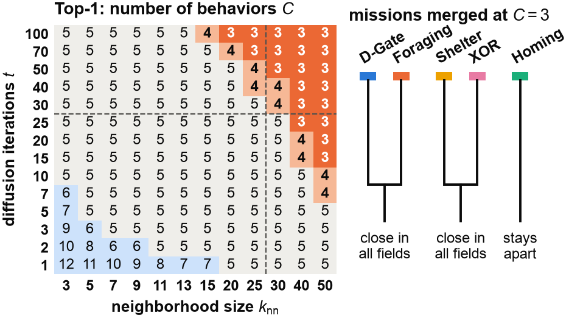 | 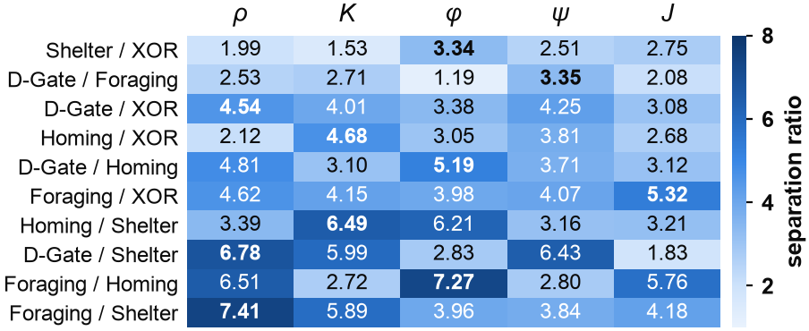 |
| *D-Gate + Foraging merge first, then Shelter + XOR; Homing remains isolated.* | *$\psi_\sigma$ separates D-Gate/Foraging (`3.35`); $\varphi_\sigma$ separates Shelter/XOR (`3.34`).* |

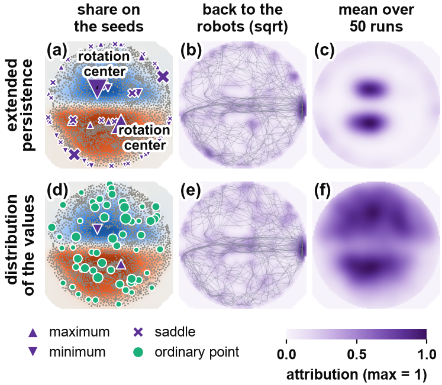

*Differentiable attribution (`notebooks/07_attribution.ipynb`): comparing D-Gate and Foraging in $\psi_{\sigma_3}$, extended persistence places `100%` of the distance split on `49` critical seeds (`13.5%` of traversed robot-path area holds half of D-Gate's map; mean half-map support `14%` vs `32%` for `62` scattered value-quantile seeds).*

---

## 📓 Interactive Educational Notebooks (`notebooks/`)

Every notebook blends mathematical intuition, toy/real experiments, inline plots, and exact verification against the pipeline checkpoints (`results/epuck/`):

| Notebook | Focus & Interactive Experiments | Plots |
| :--- | :--- | :---: |
| [`00_paper_figures.ipynb`](notebooks/00_paper_figures.ipynb) | Regenerates every main and appendix paper figure, Table 2 summary, and `make_numbers.py` audit | 19 |
| [`01_data_and_fields.ipynb`](notebooks/01_data_and_fields.ipynb) | Gaussian footprint, live crossing-streams $M_0/\mathbf{M}_1/M_2$ test, finite-diff HHD check (`3.70e-03`), live $J_\sigma$ test, $90^\circ$ GPU rotation check | 7 |
| [`02_scales_domain_persistence.ipynb`](notebooks/02_scales_domain_persistence.ipynb) | Geometric scale ladder vs uncapped collapse, 3-family grid-free alpha complex, 1-D sweep + live GUDHI diagram match | 5 |
| [`03_distances_and_fusion.ipynb`](notebooks/03_distances_and_fusion.ipynb) | Diagonal augmentation & $\mathrm{SW}_1$ direction convergence, 20 rank-normalized views, raw vs quantile histograms, moment-balanced SNF contrast | 5 |
| [`04_taxonomy.ipynb`](notebooks/04_taxonomy.ipynb) | Affinity Propagation plateau co-association, exemplar selection frequency, Top-1 $\to$ Top-10 scaling curves & global state transitions | 7 |
| [`05_hierarchy_and_fields.ipynb`](notebooks/05_hierarchy_and_fields.ipynb) | Exact merge sequence contingency matrices ($C=4, 3$), between/within field separation profiles, late-settling XOR analysis | 5 |
| [`06_ablation_baselines_robustness.ipynb`](notebooks/06_ablation_baselines_robustness.ipynb) | 11-combination field ablation, Top-1 & Top-10 baseline comparisons, rotation invariance, AP convergence & fusion design tables | 3 |
| [`07_attribution.ipynb`](notebooks/07_attribution.ipynb) | End-to-end differentiable PyTorch attribution checks (`<1e-7`), cumulative sparsity curve, 2 mm noise stability across all 10 mission pairs | 3 |

---

## 📂 Repository Structure

```
paper_topological_kinematics/
│
├── README.md                              # Project documentation, math, results & gallery
├── CITATION.cff                           # Machine-readable citation metadata
├── LICENSE                                # MIT License (code); CC BY 4.0 (Zenodo derived results)
├── requirements.txt                       # Exact Python 3.12 + CUDA/Triton package versions
│
├── run_pipeline.py                        # Stages 1–3: seeds + fields, extended persistence, SW1 matrices
├── run_sweep.py                           # Clustering sweep, standard SNF, ablation, modal plateau consensus
├── make_zenodo_bundle.sh                  # Builds Zenodo archive (10.5281/zenodo.23440748)
├── make_submission_bundle.sh              # Builds self-contained Swarm Intelligence submission archive
├── make_arxiv_bundle.sh                   # Builds standalone arXiv LaTeX archive
│
├── assets/                                # Animated educational GIFs for documentation
│   ├── gaussian_splatting_demo.gif
│   ├── swarm_kinematic_fields.gif
│   └── extended_persistence_demo.gif
│
├── pipeline/                              # Stage runners, checkpoints, data loader, config
│   ├── config.py, io.py, progress.py, checkpoint.py, ranking.py
│   └── stage1_seeds.py, stage2_persistence.py, stage3_distances.py
│
├── src/                                   # Core CPU & GPU/Triton mathematical library (see src/README.md)
│   ├── gaussian_splatting/                # fields_cpu.py, fields_gpu.py, seeds_gridfree.py, alpha.py, persistence.py, distance.py, swd_gpu.py, scale_ladder.py
│   └── classification/                    # fusion.py, snf.py, affinity.py, ap.py, kernels_gpu.py
│
├── analysis/                              # Figures, tables, ablations, attribution & verification scripts (see analysis/README.md)
│   ├── run_all.sh                         # Resumable end-to-end reproduction script (stages 1–3 -> PDF)
│   ├── verify_code.py                     # 8 code-vs-formula + CPU/GPU bit-exact checks
│   ├── make_numbers.py                    # Writes 832 LaTeX macros & verifies 136 textual claims
│   ├── make_readme_visuals.py             # Generates animated GIFs in assets/
│   ├── illustrations.py, make_figures.py, figlib.py
│   └── attribution.py, attribution_pairs.py, baselines*.py, fusion_designs.py, invariance_check.py, parameter_study.py, stable_states.py, ...
│
├── notebooks/                             # Executed educational & reproduction notebooks (00–07)
├── figures/                               # Publication PDF + PNG figures (see figures/README.md)
└── manuscript/                            # LaTeX sources (paper.tex, journal.tex, supplementary.tex), checks & formal proofs
    ├── build.sh                           # Compiles paper.pdf, journal.pdf, supplementary.pdf
    ├── verify_propositions.py             # SymPy symbolic & SciPy quadrature proofs
    ├── checks/                            # check_margins.py, check_floats.py
    └── lean/                              # Lean 4 + Mathlib machine-checked proofs (TopologicalKinematics/Basic.lean)
```

---

## 🔍 Mathematical & Implementation Verification

Multiple independent verification suites audit every formula, GPU kernel, theorem, and reported number:

1. **Lean 4 Machine-Checked Proofs (`manuscript/lean/`)**: `TopologicalKinematics/Basic.lean` proves Propositions 1 (closed-form HHD), 2 ($\mathrm{SO}(2)$ invariance & mirror antisymmetry), and 3 ($5\sigma$ Gaussian tail bound) using Mathlib with standard axioms only (`[propext, Classical.choice, Quot.sound]`).
2. **SymPy Symbolic & Quadrature Verification (`manuscript/verify_propositions.py`)**: Symbolically confirms $F - v \exp(-r^2/(2\sigma^2)) = 0$, Poisson equations, rotation invariants, closed-form potential gradients (to `<=4.2e-11` relative error down to $|d|=0$), SciPy quadrature tail matching to `5.07e-17`, and envelope/fixed-seed properties.
3. **Code-to-Formula & CPU/GPU Parity (`analysis/verify_code.py`)**: Verifies $\kappa_\sigma(0) = 1/2$, direct float64 $J_\sigma$, lower-star filtration, and exact CPU $\leftrightarrow$ GPU parity (distances, SNF, and scikit-learn Affinity Propagation bit for bit; fields to float32 rounding).
4. **Live Numerical & Claim Audit (`analysis/make_numbers.py`)**: Recomputes `832` LaTeX macros across 10 generated tables and verifies **136 of 136 textual claims** directly against stored outputs (printing `CLAIM FAILS` if any statement ever diverges).

---

## ⚡ Quick Start & Full Reproducibility

### 1. Environment Installation

```bash
git clone https://github.com/Vertu5/paper_topological_kinematics.git
cd paper_topological_kinematics
pip install -r requirements.txt
```

> **CPU vs GPU parity:** With CUDA (`torch` + `triton`), stages 1, 3, fusion, Affinity Propagation, and differentiable attribution run on GPU; without a GPU, the identical mathematical method executes on CPU.

### 2. Reproduce All Pipeline Results, Checks, Notebooks & PDFs

```bash
# Place raw ARGoS CSV tracks under data/ (see Data Provenance below), or restore Zenodo checkpoints into results/
nohup nice -n 19 bash analysis/run_all.sh > results/run_all.log 2>&1 &

# Resume from a specific stage (e.g. figures, numbers, paper)
FROM=paper bash analysis/run_all.sh
```

To run the mathematical audits and compile all three PDFs standalone:

```bash
python manuscript/verify_propositions.py
python analysis/verify_code.py
python analysis/make_numbers.py
bash manuscript/build.sh
```

---

## 📦 Data Provenance, Archive & License

- **Upstream ARGoS recordings**: Simulated runs of 20 e-puck robots ($4.91\text{ m}^2$ dodecagonal arena, recorded every $0.1\text{ s}$) executing AutoMoDe-Chocolate probabilistic finite-state machines from [Legarda Herranz, Garone, and Birattari (2026)](https://github.com/glegarda/swarm-tda) and [Hasselmann et al. (*Nat. Commun.* 2021)](https://doi.org/10.1038/s41467-021-24642-3). Ten ranked controllers per mission $\times$ 50 seeds yield $2,500$ recordings (`Top-n` pools the $n$ best controllers per mission into $250n$ runs).
- **Zenodo derived results & code archive**: [`10.5281/zenodo.23440748`](https://doi.org/10.5281/zenodo.23440748) (built with `make_zenodo_bundle.sh`).
- **Licenses**: Code released under the **MIT License** ([`LICENSE`](LICENSE)); Springer Nature LaTeX template files (`sn-jnl.cls`, `sn-apacite.bst`) retain their own licenses; derived Zenodo results released under **CC BY 4.0**.

---

## 📖 Citation

If you use this codebase, formal proofs, or derived results, please cite [`CITATION.cff`](CITATION.cff):

```bibtex
@software{ndinga_oba_2026_topological_kinematics,
  author    = {Ndinga Oba, Olivier Vertu},
  title     = {Recovering a Taxonomy of Collective Behaviors from Motion Alone: code and derived results},
  year      = {2026},
  month     = oct,
  publisher = {Zenodo},
  doi       = {10.5281/zenodo.23440748},
  url       = {https://github.com/Vertu5/paper_topological_kinematics}
}
```
